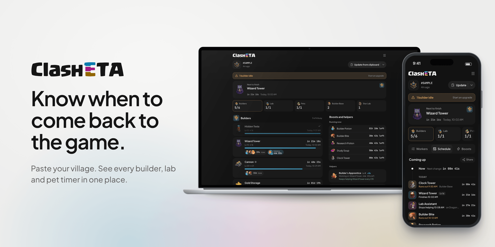
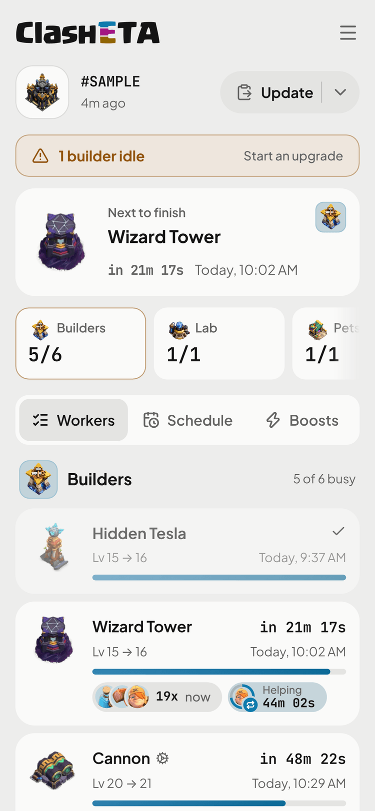
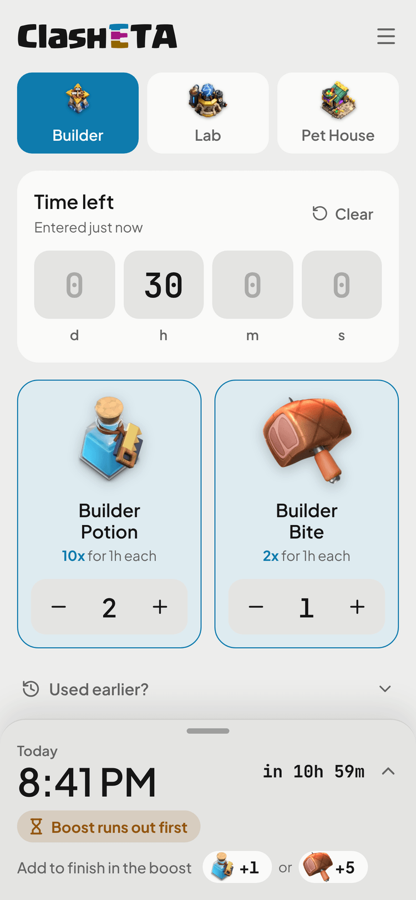
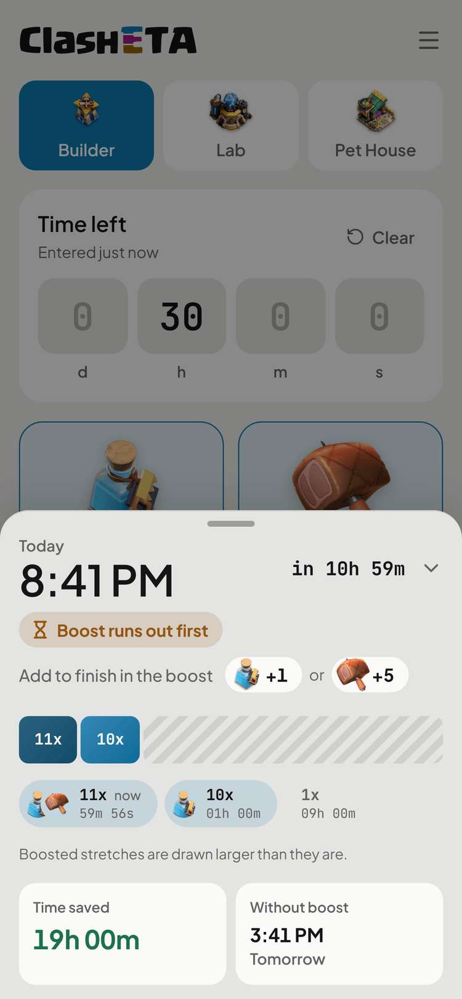
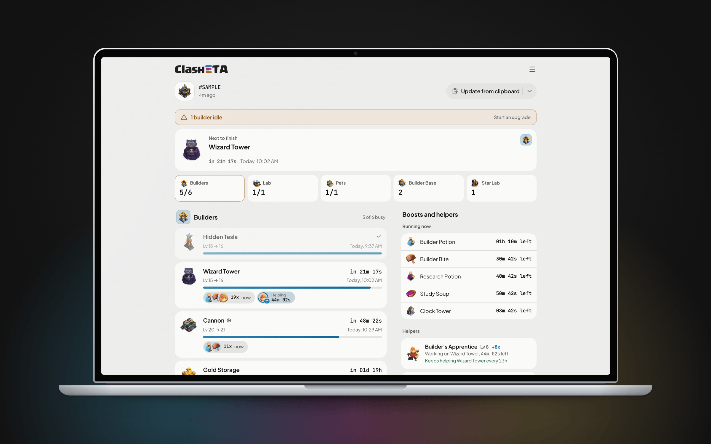
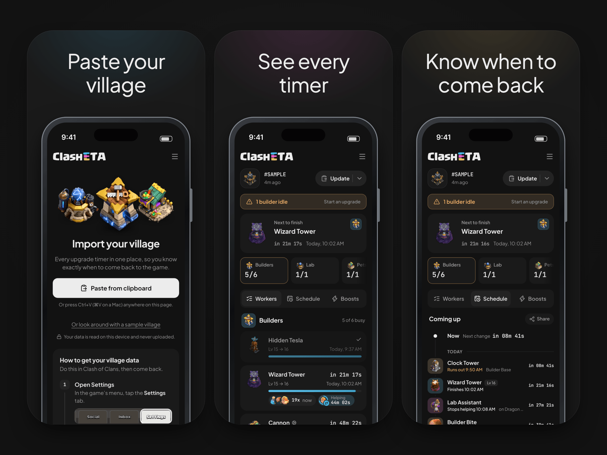

# ClashETA

<p align="center"></p>

ClashETA shows when your Clash of Clans upgrades finish. Paste your village and every builder, lab and pet timer sits on one clock, with a warning when a builder is idle. A second tool works out the finish time of a single upgrade once potions and Magic Snacks are counted. It is an Android app, built with Capacitor from the same Astro site (see [docs/android.md](docs/android.md)).

This is an unofficial fan tool. It is not affiliated with Supercell.

## What it does

- **My village** (`/village`): paste the village JSON you copy from the game and see every builder, lab and pet house timer on one clock, with a warning for idle builders, a schedule of what finishes when, and a plan-a-potion what-if.
- **Finish time** (`/finish`): works out the finish time for one upgrade with any mix of Builder Potions, Research and Pet Potions, Builder Bites and Study Soup. The result sheet shows a timeline of each boost and the time saved.
- Works with no signal: every page and picture is inside the app.
- Dark and light themes. The accent colour follows the upgrade type: cyan for builder, magenta for lab, gold for pets.

## Screenshots

<p align="center">
  <picture>
    <source media="(prefers-color-scheme: dark)" srcset="docs/images/phone-village-dark.png">
    
  </picture>
  <picture>
    <source media="(prefers-color-scheme: dark)" srcset="docs/images/phone-finish-dark.png">
    
  </picture>
  <picture>
    <source media="(prefers-color-scheme: dark)" srcset="docs/images/phone-saved-dark.png">
    
  </picture>
</p>

<p align="center"></p>

<p align="center"></p>

## Run it locally

You need Node 24 or newer.

```
npm install
npm run dev      # dev server
npm test         # unit tests
npm run build    # static site in dist/
npm run android  # builds the site, then creates or updates the Android project (docs/android.md)
npm run format   # Biome lint and format
```

`dev`, `test` and `build` first generate the game data and pictures from the pinned `clash-of-clans-data` package, so they need network access on a fresh clone. Those generated files are not committed.

## How it is built

Astro, with one React island for the interactive part. The boost math is plain TypeScript in `src/engine/` and has its own tests. Colours live only in `src/styles/tokens.css`, and each component owns a `*.module.css`.

```
src/
  engine/                  boost math
  features/finish/         Finish time: controls, result sheet, state
  village/                 My village: import, catalog, schedule
  ui/                      shared inputs and the logo
  styles/                  tokens.css, base.css
  pages/, layouts/         Astro pages and the shared shell
brand/                     logo sources and the social preview page
src/native/                the only code that knows about the Android app
capacitor.config.json      app id, name and plugin settings
docs/                      longer notes (see below)
scripts/                   build, data and screenshot scripts
```

Code conventions are in [CODE_STYLE.md](CODE_STYLE.md).

## Which page opens first

`/` checks the "Start on" setting. On Auto, a player with a saved village goes to `/village.html`, and everyone else sees the calculator at `/finish.html`. The setting can also force either page. The check runs in the head of `src/pages/index.astro`, before anything paints.

## Game data and updates

All game data and item art come from the [clash-of-clans-data](https://github.com/chiefpansancolt/clash-of-clans-data) package (MIT), pinned in `package-lock.json`. A daily GitHub Action opens a pull request when the package has a release at least 3 days old, and Dependabot handles the other dependencies weekly. You review the preview and merge.

## More documentation

- [docs/game-data-updates.md](docs/game-data-updates.md): the update workflow and how to turn on auto-merge
- [docs/game-data-and-art.md](docs/game-data-and-art.md): data sources, boost values, item art, per-level pictures, Fan Content Policy notes
- [docs/import-village.md](docs/import-village.md): village import, the math and the data pipeline
- [docs/brand.md](docs/brand.md): logo files, icon build, social preview image and site URL
- [docs/android.md](docs/android.md): the Android app, how the APK is built, signing, toolchain versions
- [docs/screenshots.md](docs/screenshots.md): retaking the README and store screenshots
- [docs/TO-CHECK.md](docs/TO-CHECK.md): open questions about the game data
- [docs/motion.md](docs/motion.md): animation and haptics notes

## License and Supercell content

The code is under the [MIT License](LICENSE). That covers the code only. The game art, item pictures and game names belong to Supercell, and the site footer says so.

Keep the project non-commercial. Supercell's Fan Content Policy bars domains and social handles that use its trademarks or game names without a written agreement. The name ClashETA has "Clash" in it, so read the policy before registering a domain or account, and never put "Clash of Clans" or "Supercell" in one.
